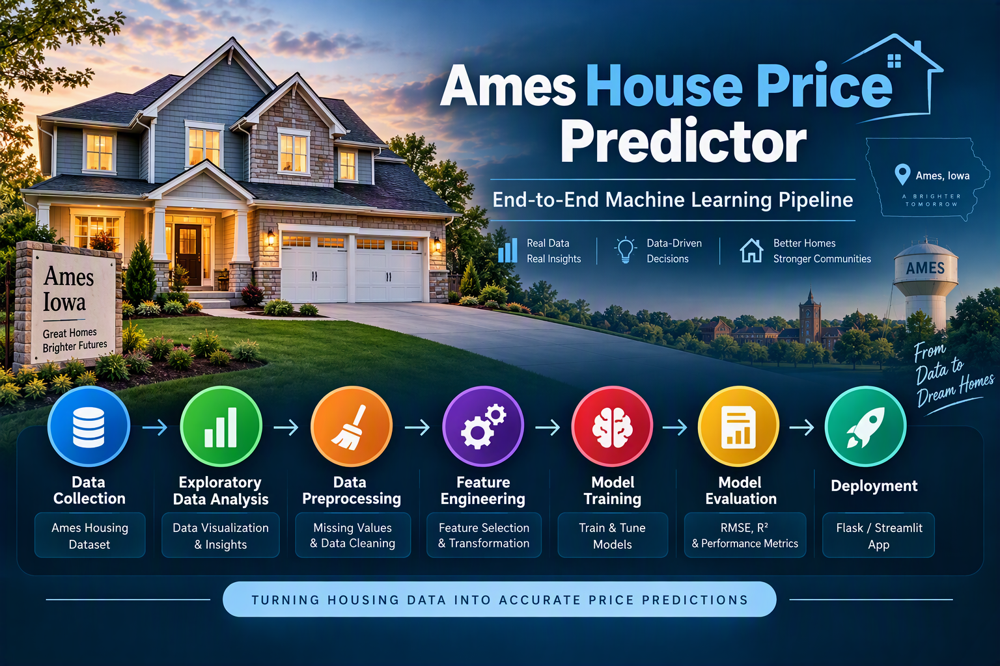
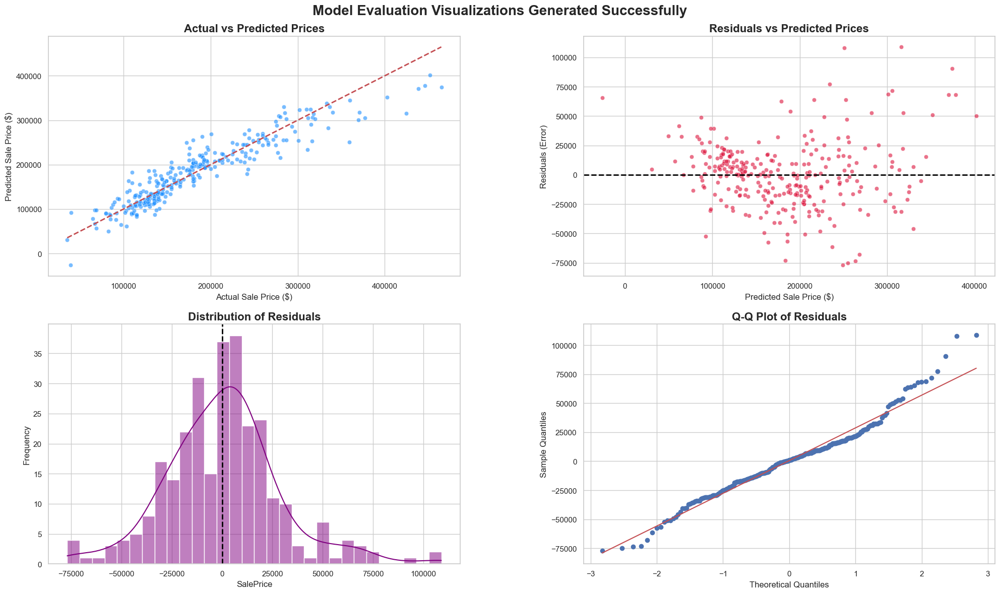

# 🏡 **Real Estate Price Prediction**


<p align="center">
  
</p>

   

   

An end-to-end **Machine Learning Regression** project that predicts residential property prices using the __Ames Housing Dataset.__

The final tuned **Ridge Regression** model achieved **R&sup2; score of 0.8659** ,explaining over **86.6% of the variance** in house prices.

---
## 📌 **Project Overview**
Accurately predicting house prices is a challenging regression task, as property values depend on multiple factors, including living area,  quality & condition, location, zone, property type, and available amenities.

This project focuses on predicting house prices using __Python, Scikit-learn, regularized regression, and SHAP__, & covers the end-to-end machine learning workflow, including:

- 🔍 Exploratory Data Analysis (EDA)
- 🧹 Data Cleaning
- ⚙️ Preprocessing & Feature Engineering
- 🤖 Baseline Model Training
- 📈 Model Tuning & Evaluation
- 🔎 SHAP Explainability
- 📊 Final Model & Insights
---
## 📂 **Dataset**
This project uses [ Ames Housing Dataset – Kaggle ](https://www.kaggle.com/datasets/prevek18/ames-housing-dataset), one of the most widely used regression dataset for machine learning.

### 📊 Dataset Overview

| Property        | Value       |
|-----------------|-------------|
| Observations    | 1,460       |
| Features        | 81          |
| Target Variable | `SalePrice` |
| Task            | Regression  | 

The dataset contains detailed information about residential properties, including:
- Property size
- Quality & Condition
- Neighborhood
- Construction year
- Garage features
- Basement Features
- Exterior Materials
- Lot Dimensions
- Sale Information

---
## 📊 **Exploratory Data Analysis (EDA)**

A comprehensive exploratory data analysis (EDA) was conducted before modeling to examine feature distributions, handle missing values, detect outliers, and uncover patterns and correlations with the target variable.

- put all 6 eda's dashboard picture

### **Key Highlights**

🏘️ **[1. Neighborhood & House Price Analysis](https://github.com/annugit1655/Real-Estate-Price-Prediction/blob/main/notebooks/02-Neighborhood-%26-Zoning-Analysis.ipynb)**
- House prices vary significantly across neighborhoods, highlighting the importance of location in property valuation.
- Larger homes generally sell for higher prices, but the impact of size varies across neighborhoods.
- Some neighborhoods command a higher price per square foot, even after accounting for house size.

🏗️ **[2. Impact of Zoning](https://github.com/annugit1655/Real-Estate-Price-Prediction/blob/main/notebooks/02-Neighborhood-%26-Zoning-Analysis.ipynb)**
- Zoning classifications are associated with differences in house sale prices.
- Residential zoning categories generally show higher sale prices than commercial categories in this analysis.
- The Floating Village Residential (FV) category particularly command premium prices due to its rarity and uniqueness.

📈 **[3. Time Series Analysis](https://github.com/annugit1655/Real-Estate-Price-Prediction/blob/main/notebooks/04-Time-and-Market-Trend-Analysis.ipynb)**
- Both home sales volume and prices show seasonal patterns, with certain times of the year bringing more activity and noticeable price changes.
- Housing prices in Ames and the seasonal decomposition showing that more recently built or remodeled homes tend to sell for higher prices.
- Remodeled house tend to sell for higher prices than non-remodeled ones, especially for homes built after 1950 but difference effect is small.

🏡 **[4. Property Price Drivers Analysis](https://github.com/annugit1655/Real-Estate-Price-Prediction/blob/main/notebooks/01-Property-Price-and-Feature-Relationship-Analyis.ipynb)**
- Living area, basement size, garage capacity, and overall material quality show strong relationships with house sale prices.
- Homes with higher overall quality and condition ratings generally sell for higher prices, with quality appearing to have a stronger influence on property value.
- Larger homes tend to have higher quality ratings and sale prices, but greater size does not necessarily indicate better maintenance or condition.

🏠 **[5. Property Type Analysis](https://github.com/annugit1655/Real-Estate-Price-Prediction/blob/main/notebooks/03-Exploring-Property-Type-Analysis.ipynb)**
- Newer, larger homes on bigger lots sell for more.
- Building type remains an important secondary factor: single-family homes are premium, while multi-unit and interior townhouse forms carry discounts.
- End-unit townhouses are the strongest exception among non-single-family types, suggesting they are more competitive with single-family values.

**[Explore the Complete EDA Notebook](https://github.com/annugit1655/Real-Estate-Price-Prediction/blob/main/notebooks)**

---
## 🔧 **Feature Engineering**

Several domain-specific features were created to improve model performance and minimize redundant information.
### 🧩 Engineered Features & Preprocessing

- 🏠 House Age = `YrSold − YearBuilt`
- 🛁 Total Bathrooms
- 📐 Total Square Footage
- 🧹 Missing Value Imputation
- 🧪 Removal of Insignificant Features Using ANOVA & T-Test

Feature engineering and preprocessing resulted in approximately **97 candidate features**, which were subsequently reduced to **25 predictors** for further analysis.

---
## 🤖 **Feature Selection & Model Development**

### 🎯 Feature Selection Techniques

- 📉 **Ridge Regression** — Used L2 regularization and coefficient analysis to identify relevant predictors.
- 🧠 **Manual Feature Selection** — Selected predictors based on domain knowledge and interpretability.

### 🧪 Model Training

- 🔀 Separate models were trained and evaluated using the feature sets obtained from each selection technique.
- 📊 Model performance was compared using predictive accuracy and generalization ability.
- 🏆 **Best-Performing Model:** Ridge Regressor
- ⚙️ **Hyperparameter Optimization:** GridSearchCV was used to identify the optimal hyperparameters.

---
## 🧮 **Model Performance**

Final Model Metrics
| Metric | Score |
|:---|---:|
| R² Score | 0.8659 |
| Mean Absolute Error (MAE) | 20931.27 |
| Root Mean Squared Error (RMSE) | 28426.01 |
---
### **Model Evaluation**


---
## 🔍 **Model Explainability (SHAP)**

---
## **💼 Business Insights**

---
## 🛠️ **Tech Stack**

| Category | Technologies |
|:---|---:|
| Programming Language | Python |
| Data Analysis | Pandas, NumPy |
| Visualization | Matplotlib, Seaborn |
| Dimensionality Reduction | PCA, MDS |
| Statistical Analysis | Statsmodels |
| Text Visualization | WordCloud |
| Clustering Visualization | Dendrogram |
| Machine Learning | Scikit-learn |
| Best Model | Ridge Regression |
| Regularization | L2 |
| Model Explainability | SHAP |
| Hyperparameter Tuning | GridSearchCV |
| Web Application | Streamlit |
| Version Control | Git, GitHub |

---
## **Getting Started**

### 1. Clone the repository
```bash
git clone https://github.com/annugit1655/Real-Estate-Price-Prediction.git
```

### 2. Install dependencies
```bash
pip install -r requirements.txt
```

### 3. Train the model (Optional)
A trained model is already included.

To retrain from scratch, open:
```bash
run all notebooks 01-11
```

---
## 🔮 Future Improvements

- 🗺️ Add geospatial features such as latitude and longitude.
- 🏘️ Identify drivers of undervalued properties.
- 🤖 Ensemble XGBoost, CatBoost, and LightGBM.
- ☁️ Deploy on Streamlit Cloud or AWS.
- 📈 Automate model retraining.
- ⚙️ Build an end-to-end MLOps pipeline.

---
## ⭐ Support
If you found this project useful, consider giving it a ⭐ Star on GitHub. It helps others discover the project and supports future improvements.

### 📚 Citation
If you use this project in academic research, publications, educational materials, or derivative works, please cite it and provide appropriate credit to the original author.

This repository includes a [CITATION.cff](#https://github.com/annugit1655/Real-Estate-Price-Prediction/blob/main/CITATION.cff) file, so GitHub provides a "**Cite this repository**" button in the repository sidebar. You can use it to obtain citations in BibTeX, APA, and other supported formats.

Yadav, Annu. (2026). Real Estate Price Prediction (Version 1.0) [Software]. GitHub.

```bash
https://github.com/annugit1655/Real-Estate-Price-Prediction
```
Author: Yadav Annu

GitHub: https://github.com/annugit1655

Contact: ayannu1655@gmail.com

If you build upon this work, attribution is appreciated and helps others discover the original project.

Note: The MIT License requires that the original copyright notice be retained in copies of the Software.

📜 License

© 2026 Yadav Annu.

This project is licensed under the MIT License. See the [LICENSE](https://github.com/annugit1655/Real-Estate-Price-Prediction/blob/main/LICENSE) file for details.


 

